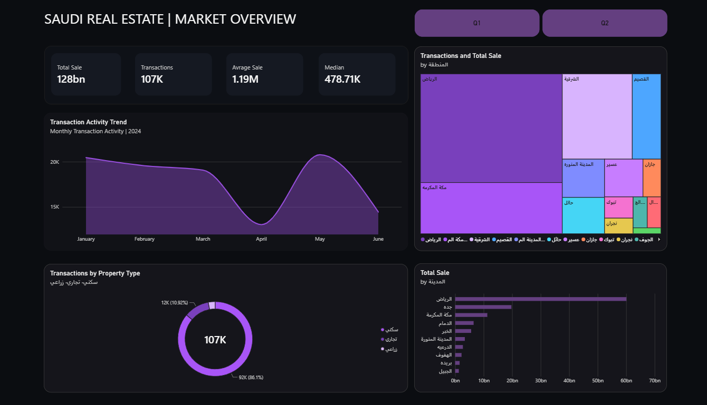

# Saudi Real Estate: Market Analysis & Transaction Value Prediction

I explored real estate sales records from Saudi Arabia for Q1 and Q2 of 2024. I cleaned the data in Python, built a one-page Power BI dashboard, and built and evaluated a basic machine learning model to predict transaction values.

> **About the data:** The records come from Saudi Ministry of Justice data shared in the https://github.com/civillizard/Saudi-Real-Estate-Data/tree/main/moj/sales . The price column is the **total recorded transaction value**, which can cover more than one property. This is not a dataset of house listing prices.

## Business questions

1. How did the number and total value of transactions change between Q1 and Q2 2024?
2. Which regions recorded the most transactions?
3. How are transactions split between residential, commercial and agricultural properties?
4. Can a basic machine learning model estimate the value of Q2 transactions using the location, property category and area?

## Data

I combined the two quarterly files and kept the quarter as a separate column.

| File | Rows |
| `data/MOJ-Sales-2024-Q1.csv` | 59,099 |
| `data/MOJ-Sales-2024-Q2.csv` | 48,272 |
| `data/real_estate_clean.csv` | 107,370 |

The data includes region, city, district, date, property classification, number of properties, transaction value and area. I removed the empty row, cleaned the numeric columns and checked for invalid values. The Power BI report uses one cleaned table.

## Measures

The main Power BI measures are:

- **Transactions:** Number of sales records
- **Total Sale:** Sum of transaction values (SAR)
- **Average Sale:** Average transaction value
- **Median:** Median transaction value

## Report page

**Market Overview** — One page with a Q1/Q2 selector, four KPI cards, monthly activity, a regional treemap, transaction types and the top cities by sales value. Selecting a region filters the other visuals.

## Machine learning

I used the available transaction information to test how well a basic regression model could estimate recorded values. I used **Q1 to train** the model and **Q2 to test** it, so the evaluation uses a later period.

- **Inputs:** Region, city, property classification, area and number of properties
- **Target:** Recorded transaction value (SAR)
- **Baseline:** Predict the Q1 median for every transaction
- **Model:** Random Forest Regressor (40 trees)

Results on **48,271 Q2 records**:

| Method | Mean absolute error (MAE) | Median absolute error |
|---|---:|---:|
| Median baseline | SAR 971,593 | SAR 313,750 |
| Random Forest | SAR 757,544 | SAR 170,733 |

The model reduced MAE by about **22%** compared with the baseline. Its R² was **0.18**, so there is still a lot it cannot explain. Large commercial transactions were especially hard to predict. This is an initial modeling approach, **not a reliable property valuation tool**.

The steps and code are in [`notebooks/Transaction_Value_Prediction.ipynb`](notebooks/Transaction_Value_Prediction.ipynb).

## Key findings (Q1 vs Q2 2024)

- The number of records decreased from **59,099 to 48,271** (**18.3%** lower).
- Total recorded value fell from **SAR 70.63B to SAR 57.49B** (**18.6%** lower).
- The median transaction value rose from **SAR 453,750 to SAR 500,000**, even as the number of transactions fell.
- **Riyadh** recorded the most transactions across the two quarters (**43,061**), followed by **Makkah** (**20,277**) and the **Eastern Region** (**16,655**).
- **Residential** transactions made up **86.1%** of the records, followed by commercial (**10.9%**) and agricultural (**3.0%**).

The rise in the median does not necessarily mean properties became more expensive. The mix of properties sold may have changed between quarters.

## Tools

Power BI Desktop · DAX · Python · pandas · NumPy · scikit-learn · Matplotlib
